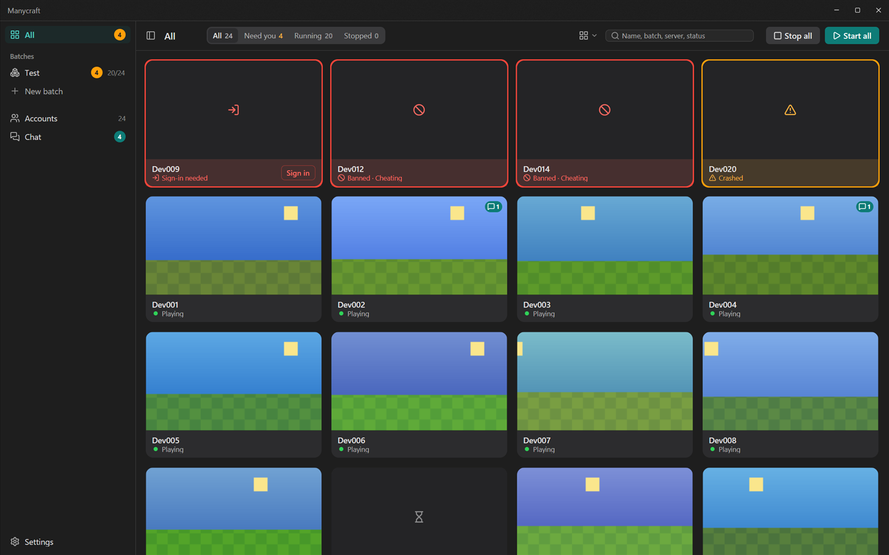
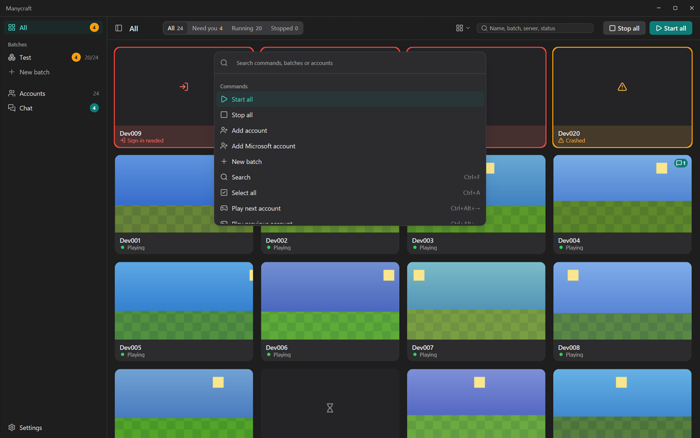
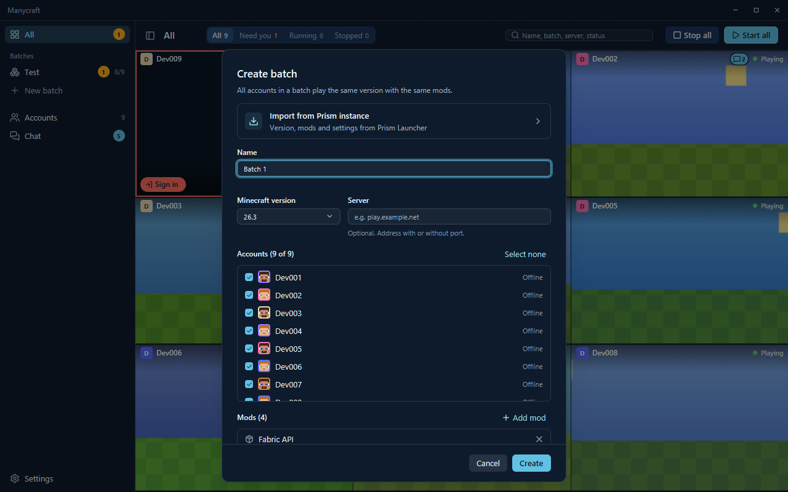
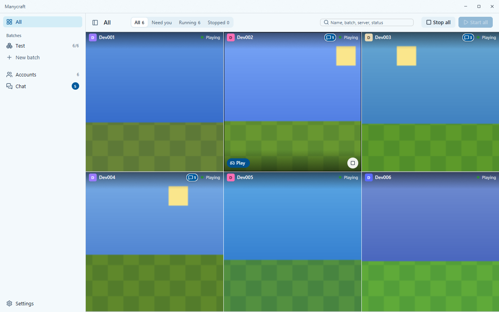
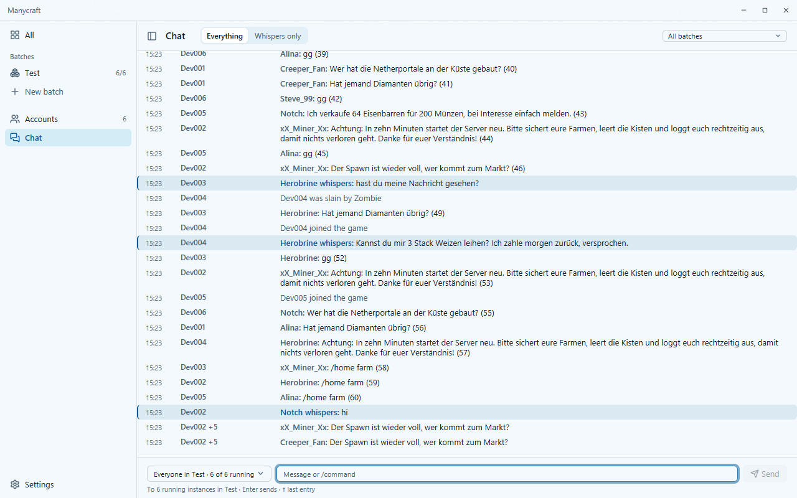

<h1 align="center">Manycraft</h1>

<p align="center">One window for all your Minecraft accounts.</p>

<p align="center"></p>

Manycraft runs many Minecraft Java accounts at once behind a single window, for example for AFK alts on servers that allow them. You get one grid of live previews; click a tile and that instance takes the window's place as a normal, fully playable game. Hidden instances are throttled to a minimal background profile, and accounts that need you (signed out, banned, crashed, dropped from the server) are highlighted and counted.

Built with Rust and [GPUI](https://www.gpui.rs). Runs on Windows, macOS and Linux with Fabric.

## Features

- **Grid:** live previews of every instance; click or hotkey swaps the real game window in at full speed
- **Batches:** groups of instances with identical Fabric mods and configs, mods from Modrinth with update checks; run several batches side by side
- **Accounts:** Microsoft and offline accounts, a proxy per account for login and game connection
- **Resilience:** auto-reconnect with polite backoff, ban detection, crash restart
- **Attention:** instances that need work are highlighted in their tile and counted, with no popups or sound
- **Chat:** one merged feed across instances, whispers highlighted, messages and commands broadcast to a whole batch
- **Import:** accounts and instances from Prism Launcher
- **Command palette:** every command by keyboard (Ctrl+K, Cmd+K on macOS)
- **Light on resources:** shared game files exist once on disk
- **Updates:** checks GitHub for new releases

<p align="center"> </p>
<p align="center"> </p>

## Install

Download the latest build from [GitHub Releases](https://github.com/schrumbo/manycraft/releases/latest).

| OS | File | Notes |
|---|---|---|
| Windows | `Manycraft-Setup-<version>-windows-x64.exe` | NSIS installer |
| macOS | `Manycraft-<version>-macos-universal.dmg` | Ad-hoc signed: right-click the app, choose Open the first time |
| Linux | `.deb` or `Manycraft-<version>-linux-x86_64.AppImage` | `chmod +x` the AppImage, then run it |

Java is downloaded automatically. Add an account, create a batch, press Start.

## Fair use

Manycraft is a window manager for your own game clients, not a bot. Check your server's rules before running several accounts. It has no anti-AFK or automation features and will not get any. See the [Code of Conduct](CODE_OF_CONDUCT.md).

## Repository

| Path | What |
|---|---|
| `src/` | The app: `core/` (accounts, install, launch, networking), `ui/` (GPUI interface) |
| `mod/` | The Fabric companion mod that every instance runs (previews, background profile, status, proxy) |

## Build from source

Requires a current stable [Rust](https://rustup.rs) toolchain and Java 25: the companion mod is built and embedded into the app during `cargo build`.

```sh
git clone https://github.com/schrumbo/manycraft.git
cd manycraft
cargo run
```

To skip the Gradle step, point `MANYCRAFT_COMPANION_JAR` at a prebuilt companion jar.

On Debian or Ubuntu, install the system libraries first:

```sh
sudo apt-get install libxkbcommon-dev libxkbcommon-x11-dev libwayland-dev libvulkan-dev \
  libx11-xcb-dev libxcb1-dev libfontconfig-dev libfreetype-dev libdbus-1-dev pkg-config
```

Run the tests with `cargo test`.

## Contributing

See [CONTRIBUTING.md](CONTRIBUTING.md).

## License

Copyright (c) 2026 Schrumbo. Licensed under the [GNU Affero General Public License v3.0](LICENSE).

Not an official Minecraft product. Not approved by or associated with Mojang or Microsoft.
