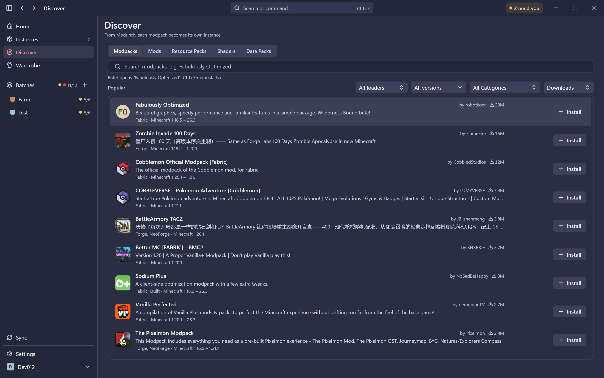
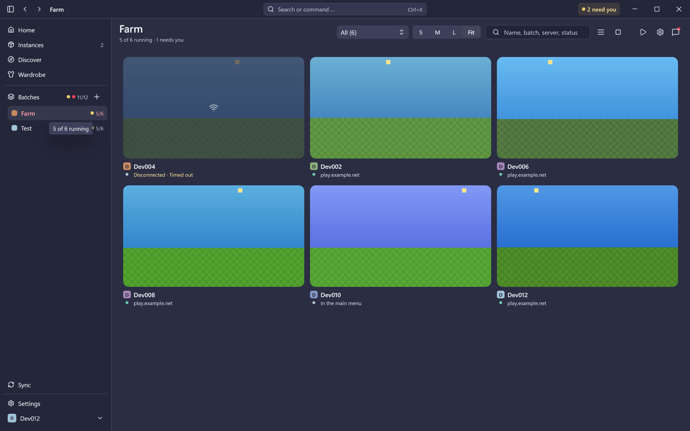

# Manycraft

A Minecraft Java launcher for Windows, macOS and Linux, with batches for running many accounts at once.



## Features

- Vanilla, Fabric, Quilt, Forge and NeoForge instances
- Mods, resource packs, shaders and modpacks from Modrinth, with updates
- Worlds with backups, screenshots, logs with crash reasons
- Microsoft and offline accounts, tokens kept in the OS keychain
- Import from Prism Launcher and `.mrpack` files

### Batches

A batch starts a group of accounts on one instance and one server. Each account gets a live tile; click it and the real game window takes its place. Hidden games drop to a low-cost background profile.

Batches can also run without a game: accounts stay on the server through a lightweight connection, and you still see what each one sees, its menus and its chat.



## Install

Download the installer for your system from [Releases](https://github.com/schrumbo/manycraft/releases/latest). Java is downloaded on first launch.

## Build

Requires stable [Rust](https://rustup.rs) and Java 25.

```sh
git clone https://github.com/schrumbo/manycraft.git
cd manycraft
cargo run
```

On Debian or Ubuntu:

```sh
sudo apt-get install libxkbcommon-dev libxkbcommon-x11-dev libwayland-dev libvulkan-dev libgl1-mesa-dev \
  libegl1-mesa-dev libx11-xcb-dev libxcb1-dev libfontconfig-dev libfreetype-dev libdbus-1-dev libasound2-dev pkg-config
```

The UI is built with [Freya](https://freyaui.dev). See [CONTRIBUTING.md](CONTRIBUTING.md) to contribute.

## Fair use

Manycraft does not play for you: it never moves, types or chats on its own. Check a server's rules before joining it with several accounts.

## License

[AGPL-3.0](LICENSE). Not an official Minecraft product; not associated with Mojang or Microsoft.
